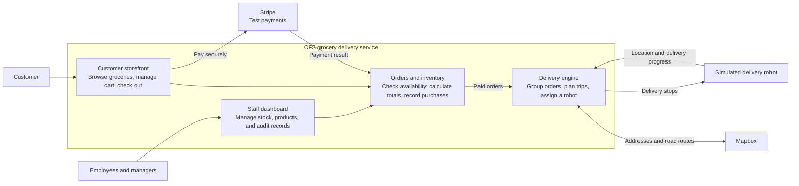

# CS160 Team 3 — OFS

Next.js 16 (TypeScript, Tailwind) + Supabase. **Everything runs in Docker**, so you don't need Node installed.

## Review and presentation

- [Presentation notes and core code logic](docs/demo-guide.md)
- [Black-box acceptance checklist](docs/black-box-checklist.md)
- [Demo rehearsal, test commands, and coverage limits](docs/testing.md)

The app remains a Stripe test-mode class project with demo tax. Delivery dispatch, traffic-aware road routing, and a simulated robot are implemented. Configure and supervise the workers before running deliveries. Customers can follow each order on a live tracking page with a map at `/track`.

See [worker deployment and recovery commands](docs/run-workers.md) and [implementation decisions](docs/implementation-decisions.md).

## First-time setup

**1. Install [Docker Desktop](https://www.docker.com/products/docker-desktop/)** and open it.

**2. Clone the repo and create your env file:**

```bash
git clone https://github.com/RonCodes88/CS160-Team3-OFS.git
cd CS160-Team3-OFS
cp .env.example .env.local
```

**3. Fill in `.env.local`.** Each variable in `.env.example` has a comment saying where to get it (Supabase, Stripe **test mode**, Mapbox), or ask the team. Never commit `.env.local`.

The server checks every variable when it starts (`src/lib/env.ts`). In development it prints a warning listing anything missing or malformed and still starts. A production server exits instead. Stripe live keys (`sk_live_`/`pk_live_`) and secret `sk.` Mapbox tokens in `NEXT_PUBLIC_` variables are always rejected.

**4. Start the app:**

```bash
docker compose up --build
```

Open **http://localhost:3000**. The footer should say `Supabase: Connected · PostGIS <version>` (see [Database](#database)).

## Everyday use

| What                  | Command                                |
| --------------------- | -------------------------------------- |
| Start the app         | `docker compose up`                    |
| Stop the app          | `Ctrl+C`, then `docker compose down`   |
| Lint                  | `docker compose exec web npm run lint` |
| Typecheck             | `docker compose exec web npm run typecheck` |
| Unit tests            | `docker compose exec web npm test`     |
| Add a package         | `docker compose exec web npm install <package>` |
| Supabase CLI          | `docker compose exec web npx supabase <command>` |

Code changes reload automatically in the browser. Commands with `exec` need the app running (`docker compose up`) in another terminal.

**After pulling changes that touch `package.json`**, rebuild once:

```bash
docker compose up --build --renew-anon-volumes
```

## Making changes

`main` is protected, so you can't push to it directly.

```bash
git checkout -b my-feature
# ...make changes, then:
git add .
git commit -m "Describe your change"
git push -u origin my-feature
```

Then open a Pull Request on GitHub. CI (lint, typecheck, unit tests, build, Docker build) runs on every PR and must pass before you can merge.

## Architecture

OFS has three main parts: a storefront for customers, a dashboard for store staff, and a delivery engine that coordinates the robot.



The customer storefront handles shopping and checkout. The staff dashboard lets employees update stock and lets managers maintain products and review changes. Both use the same order and inventory information, so purchases and staff edits affect what customers can buy.

After a successful payment, the delivery engine groups orders within the robot's capacity, plans a route, and assigns an available robot. The simulated robot reports its location and delivery progress. Stripe handles test payments, and Mapbox supplies address and road-routing information.

This diagram groups the product's responsibilities. The implementation uses one Next.js application with a shared database and separate background workers. The tracking API exists; the customer-facing live map is still a placeholder.

Read [technical architecture and code ownership](docs/architecture.md), [API flows](docs/api-flows.md), and [demo rehearsal and test limits](docs/testing.md) for implementation details. The [presentation guide](docs/demo-guide.md) gives a short spoken walkthrough.

## Codebase structure

```text
src/
  app/                 Next.js pages, layouts, and API handlers
    api/               auth, products, cart, checkout, staff, admin, vehicle, orders
    shop/              Catalog and product detail pages
    cart/              Cart page
    checkout/          Checkout page
    orders/            Private order confirmation
    staff/             Employee and manager dashboard
  components/          React UI grouped by cart, checkout, shop, staff, layout, ui
  lib/                 Server services, validation, provider adapters, pure rules
    auth/              Accounts, hashed sessions, roles, addresses, service area
    cart/              Pricing and cart mutations
    checkout/          Preview validation and demo tax
    payments/          Stripe, idempotency, finalization, refunds, recovery
    orders/            Order reads, queue, customer tracking data
    delivery/          Batching, dispatch, vehicle assignment and departure
    routing/           Stop ordering, Mapbox routes, route persistence
    vehicle/           Vehicle location, stop transitions, simulator logic
    notifications/     Notification messages, delivery, and retry state
    catalog/           Catalog queries and sample data
    inventory/         Inventory input validation
    products/          Product validation
    audit/             Staff change audit records
    supabase/          Browser, server, and privileged database clients
    api/               Shared API errors
    db/                Database health checks
scripts/               Delivery worker, recovery worker, robot simulator
supabase/migrations/   Versioned schema and transactional database functions
supabase/tests/        SQL rollback, inventory, and concurrency checks
supabase/seed.sql       Local demo accounts and catalog
e2e/                   Browser failure regressions with fixed provider responses
e2e-live/              Real app, real local database, API and browser journeys
docs/                  Architecture, API flows, testing, and presentation guides
```

Tests also live beside the code as `*.test.ts`, `*.test.tsx`, and `*.db.test.ts`. `src/proxy.ts` handles Supabase cookie refresh. OFS API authorization uses the custom sessions in `src/lib/auth`.

## Database

PostgreSQL on Supabase, with **PostGIS** for delivery locations. PostGIS is enabled by a migration in the `extensions` schema, and `extensions` is on the search path, so `geography(Point, 4326)` and `ST_*` functions work without a prefix. Run the commands below inside Docker (`docker compose exec web npx supabase ...`) or with Node installed.

- **Team access:** the project owner invites teammates from the Supabase dashboard → Organization settings → Team.
- **Health check:** the footer shows `Supabase: Connected · PostGIS <version>` when the server can run a query with `SUPABASE_SECRET_KEY` (it calls `public.db_health()`). If it says `db_health() is missing`, the hosted database is behind on migrations.
- **Apply migrations to the hosted project** (one person, after a migration PR merges):
  ```bash
  npx supabase login
  npx supabase link --project-ref <project-ref>   # from the dashboard URL
  npx supabase db push
  ```
- **Local database for DB tests:** `npx supabase start` runs Postgres with every migration applied. `npx supabase db reset` re-applies them from scratch. Copy the API URL and secret key from `npx supabase status` into `.env.test.local` as `SUPABASE_TEST_URL` and `SUPABASE_TEST_SECRET_KEY`. Then `npm test` also runs the `*.db.test.ts` files.
- **Keeping your local database up to date:** pulling a teammate's migration doesn't change your local database. Check for migrations you haven't applied yet with:
  ```bash
  npx supabase migration list --local    # a blank "Remote" column means not applied yet
  npx supabase migration up --local      # applies only the missing ones, keeps your data
  ```
  These run on your machine, not through `docker compose exec web`, because the app container can't reach the local database. You need Node.js and `npm install`, which installs the Supabase CLI from `devDependencies` (nothing else to install). You also need Docker Desktop open, and the local database started once with `npx supabase start`. To check the hosted project instead, use `--linked` (needs `npx supabase login` and `link` first).
- **Demo accounts:** `npx supabase db reset` also loads `supabase/seed.sql`: the sample catalog plus `customer.test`, `employee.test`, `manager.test`, and `vehicle.test` `@ofs.local`, all with the password `ChangeMe123!`. Local and demo only.
- **Schema changes:** add a new migration (`npx supabase migration new <name>`). Never edit one that's already applied.

## Dependencies

Ask the team before adding a new package. All of these are installed by `npm ci` (or the Docker build).

| Package                                         | Used for                                                                 |
| ----------------------------------------------- | ------------------------------------------------------------------------ |
| `next`, `react`, `react-dom`                    | App framework (pages, API route handlers)                                |
| `@supabase/supabase-js`, `@supabase/ssr`        | PostgreSQL (Supabase) client on the server and in the browser            |
| `@node-rs/argon2`                               | Argon2id password hashing (prebuilt binaries, no compiler needed)        |
| `stripe`                                        | Server-side Stripe: PaymentIntents, refunds/voids, webhook signature checks |
| `@stripe/stripe-js`, `@stripe/react-stripe-js`  | Stripe Payment Element in the checkout page, so card data never touches OFS |
| `@mapbox/search-js-core`                        | Mapbox Geocoding v6: turn delivery addresses into coordinates            |
| `@mapbox/mapbox-sdk`                            | Mapbox Directions and Optimization APIs for robot routes                 |
| `mapbox-gl`, `react-map-gl`                     | Interactive map for delivery tracking (import from `react-map-gl/mapbox`) |
| `lucide-react`                                  | Icons                                                                    |
| `tailwindcss`                                   | Styling (dev)                                                            |
| `vitest`                                        | Unit and component tests: `npm test` (dev)                               |
| `@playwright/test`                              | End-to-end browser tests (dev); run `npx playwright install` once for browsers |
| `eslint`, `typescript`                          | Lint and typecheck: `npm run lint`, `npm run typecheck` (dev)            |
| `supabase`                                      | Supabase CLI for local DB and migrations (dev)                           |

## Troubleshooting

- **`Supabase: Not configured`**: `.env.local` is missing or empty. Fill it in, then restart with `docker compose up`.
- **Port 3000 already in use**: stop whatever else is running on 3000, or change `"3000:3000"` to `"3001:3000"` in `compose.yaml` and use http://localhost:3001.
- **`Could not find the function/table/column ... in the schema cache`, or `relation "..." does not exist`**: your database is missing a migration. In DB tests or against local Supabase, run `npx supabase migration list --local`, then `npx supabase migration up --local`. Against the hosted project, someone needs to run `npx supabase db push` (see [Database](#database)).
- **`fetch failed` or `ECONNREFUSED 127.0.0.1:54321` in DB tests**: local Supabase isn't running. Start it with `npx supabase start`.
- **Something is weird after pulling**: reset the container with `docker compose down` and then `docker compose up --build --renew-anon-volumes`.

### Delivery worker

Run `docker compose --profile workers up --build -d` to start the web app plus delivery and recovery workers, or run `npm run delivery:worker` in a separate terminal after starting local Supabase
and applying migrations. It reads `.env.local`, including the backend Supabase
credentials and Mapbox configuration used by the routing service.
`OFS_DELIVERY_WAIT_MINUTES` defaults to 20 and must be positive.

The worker checks immediately on startup, then once per minute without overlapping
ticks. Trips with 10 orders, 200 lb, or an expired oldest-order wait are atomically
assigned and handed to routing. Other orders stay queued. “Immediately when full”
means the next worker check (normally within a minute). After routing, the worker atomically assigns an AVAILABLE vehicle and marks the trip and its orders OUT_FOR_DELIVERY. Routed trips wait when no vehicle is available. Keep the worker running separately from Next.js;
`npm run delivery:worker -- --once` performs one tick. Ctrl+C stops after in-flight work.
