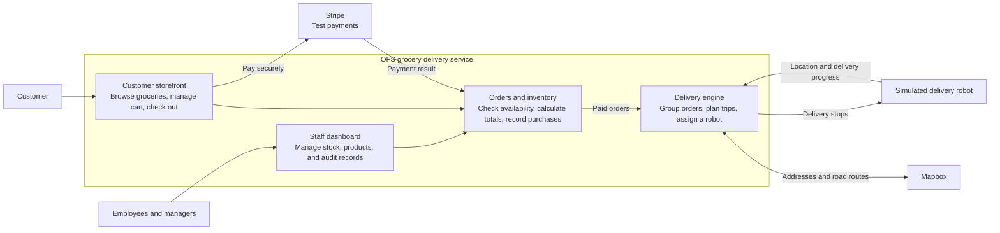
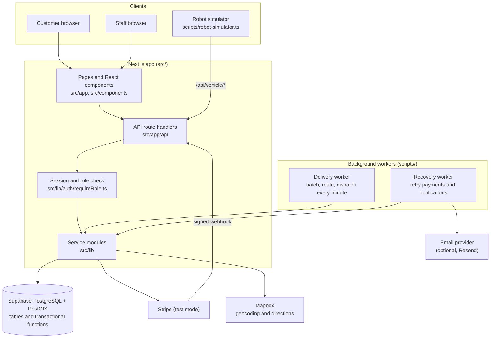
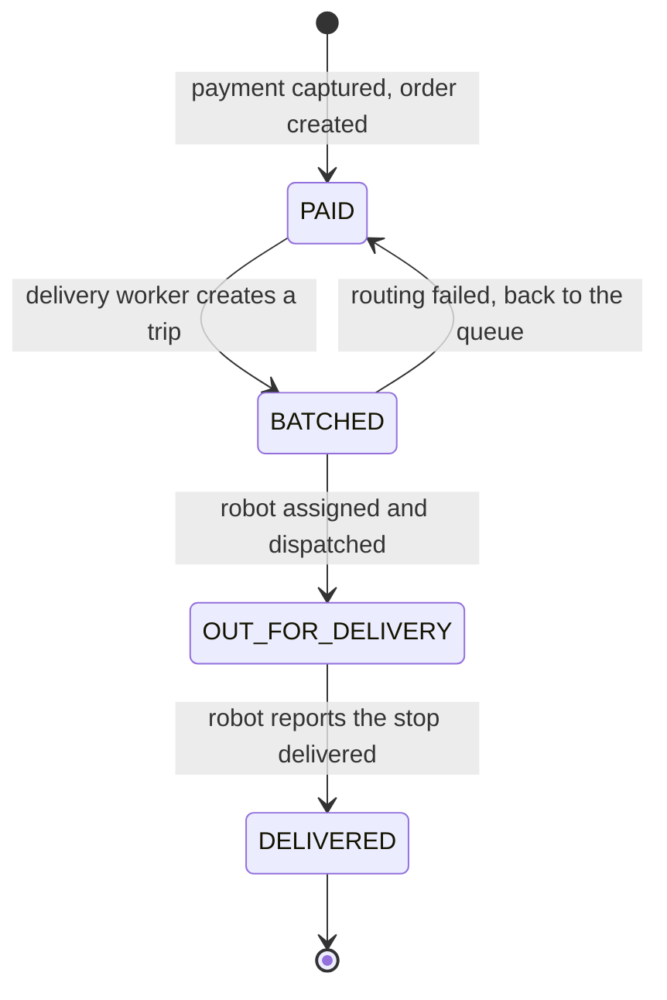

# CS160 Team 3 — OFS

Next.js 16 (TypeScript, Tailwind) + Supabase. The app runs in Docker, so testers do not need Node installed. The default setup connects to the Supabase project in `.env.local`; it does not create a database.

## Review and presentation

- [Presentation notes and core code logic](docs/demo-guide.md)
- [Black-box acceptance checklist](docs/black-box-checklist.md)
- [Demo rehearsal, test commands, and coverage limits](docs/testing.md)

The app remains a Stripe test-mode class project with demo tax. Delivery dispatch, traffic-aware road routing, and a simulated robot are implemented. Configure and supervise the workers before running deliveries. Customers can follow each order on a live tracking page with a map at `/track`.

See [worker deployment and recovery commands](docs/run-workers.md) and [implementation decisions](docs/implementation-decisions.md).

## First-time setup

**1. Install [Docker Desktop](https://www.docker.com/products/docker-desktop/)** and open it.

**2. Clone the repo and create your env file:**

```bash
git clone https://github.com/RonCodes88/CS160-Team3-OFS.git
cd CS160-Team3-OFS
cp .env.example .env.local
```

**3. Place the supplied `.env.local` in the repository root.** If you are preparing it yourself, fill in `.env.example`, including `OFS_DATABASE_URL` for migrations, and save it as `.env.local`. Use a dedicated test database and Stripe **test mode**. Never commit `.env.local`. See [tester setup and credentials](docs/tester-setup.md).

The server checks every variable when it starts (`src/lib/env.ts`). In development it prints a warning listing anything missing or malformed and still starts. A production server exits instead. Stripe live keys (`sk_live_`/`pk_live_`) and secret `sk.` Mapbox tokens in `NEXT_PUBLIC_` variables are always rejected.

**4. Start the app:**

```bash
docker compose up --build
```

Open **http://localhost:3000**. The footer should say `Supabase: Connected · PostGIS <version>` (see [Database](#database)).

Docker first runs a `migrate` container to apply pending migrations to `OFS_DATABASE_URL`. The app and workers wait for it to succeed. Already applied migrations are skipped. Startup never resets the database or reloads demo data. If migrations fail, fix the reported connection or SQL error and run the same command again.

Compose requires `.env.local` and reads it automatically. After changing it, run `docker compose up --build` again to recreate the container with the new values. To include delivery batching and the simulated robot in that same command, configure the `OFS_IN_APP_*` settings in the [tester guide](docs/tester-setup.md).

## Everyday use

| What                  | Command                                |
| --------------------- | -------------------------------------- |
| Start the app         | `docker compose up`                    |
| Stop the app          | `Ctrl+C`, then `docker compose down`   |
| Lint                  | `docker compose exec web npm run lint` |
| Typecheck             | `docker compose exec web npm run typecheck` |
| Unit tests            | `docker compose exec web npm test`     |
| Add a package         | `docker compose exec web npm install <package>` |
| Supabase CLI          | `docker compose exec web npx supabase <command>` |

Code changes reload automatically in the browser. Commands with `exec` need the app running (`docker compose up`) in another terminal.

**After pulling changes**, rebuild once:

```bash
docker compose up --build
```

The development container checks the package manifests at startup and refreshes its private dependency volume when they change.

## Making changes

`main` is protected, so you can't push to it directly.

```bash
git checkout -b my-feature
# ...make changes, then:
git add .
git commit -m "Describe your change"
git push -u origin my-feature
```

Then open a Pull Request on GitHub. CI (lint, typecheck, unit tests, build, Docker build) runs on every PR and must pass before you can merge.

## Architecture

OFS has three main parts: a storefront for customers, a dashboard for store staff, and a delivery engine that coordinates the robot.

### Product view



The customer storefront handles shopping and checkout. The staff dashboard lets employees update stock and lets managers maintain products and review changes. Both use the same order and inventory information, so purchases and staff edits affect what customers can buy.

After a successful payment, the delivery engine groups orders within the robot's capacity, plans a route, and assigns an available robot. The simulated robot reports its location and delivery progress, and customers follow it on the tracking page. Stripe handles test payments, and Mapbox supplies address and road-routing information.

### Technical view

The product parts above run as one Next.js application, one PostgreSQL database, and three separate Node processes.



How a request moves through the code:

1. A page in `src/app` renders components from `src/components`. A browser action calls a handler in `src/app/api`.
2. The handler calls `requireRole`, which hashes the session cookie, loads the user, and returns 401 or 403 when access is not allowed.
3. The handler validates the input and calls a service in `src/lib`, passing the user ID from the session.
4. The service applies the business rules and calls a PostgreSQL function. Changes that must stay consistent (cart edits, order creation, stock updates, trip dispatch) each run as one database transaction.
5. The handler returns the committed result or an error shaped as `{ error: { code, message } }`.

The services named in the design (Auth, Catalog, Cart, Checkout, Order, Delivery Batching, Route Optimization, Vehicle Tracking, Inventory, Notification) are folders in `src/lib`, not separate deployments. The delivery worker and recovery worker import the same modules, so the rules are written once.

### Order lifecycle



Every status change writes a row to `order_status_history`. The schema also allows `PREPARING` and `CANCELED`.

## Documentation

| Document | What it covers |
| --- | --- |
| [Architecture and code ownership](docs/architecture.md) | Components, where to find the code for each topic, concurrency |
| [API reference](docs/api-reference.md) | Every endpoint: access, inputs, outputs, error codes |
| [API flows](docs/api-flows.md) | Sign-in, cart, checkout and payment, delivery, and robot workflows with diagrams |
| [Data model](docs/data-model.md) | Tables, relationships, status values, and database functions |
| [Presentation guide](docs/demo-guide.md) | Short spoken walkthrough and a five-minute demo |
| [Testing and rehearsal](docs/testing.md) | Test suites, commands, and what they do not prove |
| [Workers and simulator](docs/run-workers.md) | Running delivery, recovery, and the simulated robot |
| [Implementation decisions](docs/implementation-decisions.md) | Why the design differs from the original plan |
| [Black-box checklist](docs/black-box-checklist.md) | Acceptance checks |

## Codebase structure

```text
src/
  app/                      Next.js pages, layouts, and API handlers
    page.tsx                Landing page
    shop/                   Catalog and product detail pages
    cart/                   Cart page
    checkout/               Checkout page
    orders/[orderId]/       Private order confirmation
    track/                  Order list and live tracking map
    staff/                  Employee and manager dashboard
    login/, register/       Sign-in and customer registration
    api/                    One route.ts per endpoint
      auth/                 register, login, logout, me
      categories/, products/  Public catalog
      cart/                 Read the cart, set a line quantity
      addresses/            Saved delivery addresses
      checkout/             preview, payment-intent, confirm, cancel
      webhooks/stripe/      Signed Stripe events
      orders/[orderId]/tracking/  Customer tracking data
      staff/inventory/      Stock search, low stock, stock updates
      admin/                Products and audit log (managers)
      vehicle/              trip, location, stops (robot)
  components/               React UI grouped by auth, cart, checkout, shop,
                            staff, tracking, layout, ui
  lib/                      Server services, validation, provider adapters, pure rules
    auth/                   Accounts, hashed sessions, roles, rate limits, addresses, service area
    catalog/                Catalog queries
    cart/                   pricing.ts (fee and weight rules), cart mutations
    checkout/               Preview validation and demo tax
    payments/               Stripe adapter, idempotent attempts, finalization, recovery
    orders/                 Order reads, delivery queue, tracking data
    delivery/               batching.ts, dispatch.ts, job.ts (one worker tick), departure.ts
    routing/                Stop ordering, Mapbox directions, route persistence
    vehicle/                Assigned trip, location, stop updates, simulator logic
    notifications/          Message text, sending, retry state
    inventory/, products/   Staff stock and manager product rules
    audit/                  Audit log reads
    supabase/               Browser, server, and privileged database clients
    api/errors.ts           Shared error response shape
    env.ts                  Startup check of environment variables
  proxy.ts                  Supabase cookie refresh
scripts/                    delivery-worker.ts, recovery-worker.ts, robot-simulator.ts
supabase/
  migrations/               Versioned schema and transactional database functions
  tests/                    SQL tests for rollback, inventory, and rate limits
  seed.sql                  Local demo accounts and catalog
e2e/                        Browser failure regressions with fixed provider responses
e2e-live/                   Real app, real local database, API and browser journeys
docs/                       The documents listed above
```

Tests live beside the code as `*.test.ts`, `*.test.tsx`, and `*.db.test.ts` (database tests that need local Supabase). OFS API authorization uses the custom sessions in `src/lib/auth`, not Supabase Auth.

## Database

PostgreSQL on Supabase, with **PostGIS** for delivery locations. PostGIS is enabled by a migration in the `extensions` schema, and `extensions` is on the search path, so `geography(Point, 4326)` and `ST_*` functions work without a prefix. Run the commands below inside Docker (`docker compose exec web npx supabase ...`) or with Node installed.

- **Team access:** the project owner invites teammates from the Supabase dashboard → Organization settings → Team.
- **Health check:** the footer shows `Supabase: Connected · PostGIS <version>` when the server can run a query with `SUPABASE_SECRET_KEY` (it calls `public.db_health()`). If it says `db_health() is missing`, the hosted database is behind on migrations.
- **Docker installations:** migrations run automatically before the app starts, using `OFS_DATABASE_URL` from `.env.local`. No Supabase login, CLI installation, or manual database command is needed on the tester's machine. The connection must target the same project as the API URL and keys. Use a session pooler URL if the direct database address requires IPv6 unavailable on the tester's network.
- **Apply migrations without Docker** (one person, after a migration PR merges):
  ```bash
  npx supabase login
  npx supabase link --project-ref <project-ref>   # from the dashboard URL
  npx supabase db push
  ```
- **Local database for DB tests:** `npx supabase start` runs Postgres with every migration applied. `npx supabase db reset` re-applies them from scratch. Copy the API URL and secret key from `npx supabase status` into `.env.test.local` as `SUPABASE_TEST_URL` and `SUPABASE_TEST_SECRET_KEY`. Then `npm test` also runs the `*.db.test.ts` files.
- **Keeping your local database up to date:** pulling a teammate's migration doesn't change your local database. Check for migrations you haven't applied yet with:
  ```bash
  npx supabase migration list --local    # a blank "Remote" column means not applied yet
  npx supabase migration up --local      # applies only the missing ones, keeps your data
  ```
  These run on your machine, not through `docker compose exec web`, because the app container can't reach the local database. You need Node.js and `npm install`, which installs the Supabase CLI from `devDependencies` (nothing else to install). You also need Docker Desktop open, and the local database started once with `npx supabase start`. To check the hosted project instead, use `--linked` (needs `npx supabase login` and `link` first).
- **Demo accounts:** `npx supabase db reset` also loads `supabase/seed.sql`: the sample catalog plus `customer.test`, `employee.test`, `manager.test`, and `vehicle.test` `@ofs.local`, all with the password `ChangeMe123!`. Local and demo only.
- **Schema changes:** add a new migration (`npx supabase migration new <name>`). Never edit one that's already applied.

## Dependencies

Ask the team before adding a new package. All of these are installed by `npm ci` (or the Docker build).

| Package                                         | Used for                                                                 |
| ----------------------------------------------- | ------------------------------------------------------------------------ |
| `next`, `react`, `react-dom`                    | App framework (pages, API route handlers)                                |
| `@supabase/supabase-js`, `@supabase/ssr`        | PostgreSQL (Supabase) client on the server and in the browser            |
| `@node-rs/argon2`                               | Argon2id password hashing (prebuilt binaries, no compiler needed)        |
| `stripe`                                        | Server-side Stripe: PaymentIntents, refunds/voids, webhook signature checks |
| `@stripe/stripe-js`, `@stripe/react-stripe-js`  | Stripe Payment Element in the checkout page, so card data never touches OFS |
| `@mapbox/search-js-core`                        | Mapbox Geocoding v6: turn delivery addresses into coordinates            |
| `@mapbox/mapbox-sdk`                            | Mapbox Directions and Optimization APIs for robot routes                 |
| `mapbox-gl`, `react-map-gl`                     | Interactive map for delivery tracking (import from `react-map-gl/mapbox`) |
| `lucide-react`                                  | Icons                                                                    |
| `tailwindcss`                                   | Styling (dev)                                                            |
| `vitest`                                        | Unit and component tests: `npm test` (dev)                               |
| `@playwright/test`                              | End-to-end browser tests (dev); run `npx playwright install` once for browsers |
| `eslint`, `typescript`                          | Lint and typecheck: `npm run lint`, `npm run typecheck` (dev)            |
| `supabase`                                      | Supabase CLI for local DB and migrations (dev)                           |

## Troubleshooting

- **`Supabase: Not configured`**: `.env.local` is missing or empty. Fill it in, then restart with `docker compose up`.
- **Port 3000 already in use**: stop whatever else is running on 3000, or change `"3000:3000"` to `"3001:3000"` in `compose.yaml` and use http://localhost:3001.
- **Migration container exits or the app never starts:** inspect `docker compose logs migrate`. Check that `OFS_DATABASE_URL` has the correct database password and points to the same project as the API keys, then run `docker compose up --build` again. Do not reset the database or repair migration history to bypass an error.
- **`Could not find the function/table/column ... in the schema cache`, or `relation "..." does not exist`**: your database is missing a migration. For Docker, check the migration logs and confirm the database connection and API credentials target the same project. For a directly run local Supabase, run `npx supabase migration list --local`, then `npx supabase migration up --local`.
- **`fetch failed` or `ECONNREFUSED 127.0.0.1:54321` in DB tests**: local Supabase isn't running. Start it with `npx supabase start`.
- **Something is weird after pulling**: reset the container with `docker compose down` and then `docker compose up --build --renew-anon-volumes`.

### Delivery worker

Run `docker compose --profile workers up --build -d` to start the web app plus delivery and recovery workers, or run `npm run delivery:worker` in a separate terminal after starting local Supabase
and applying migrations. It reads `.env.local`, including the backend Supabase
credentials and Mapbox configuration used by the routing service.
`OFS_DELIVERY_WAIT_MINUTES` defaults to 20 and must be positive.

The worker checks immediately on startup, then once per minute without overlapping
ticks. Trips with 10 orders, 200 lb, or an expired oldest-order wait are atomically
assigned and handed to routing. Other orders stay queued. “Immediately when full”
means the next worker check (normally within a minute). After routing, the worker atomically assigns an AVAILABLE vehicle and marks the trip and its orders OUT_FOR_DELIVERY. Routed trips wait when no vehicle is available. Keep the worker running separately from Next.js;
`npm run delivery:worker -- --once` performs one tick. Ctrl+C stops after in-flight work.
