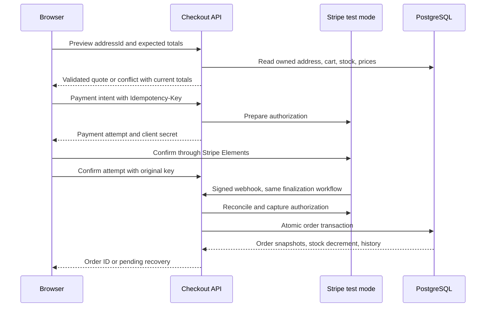

# Core API flows

API handlers live under `src/app/api`. These paths describe the implemented application. They are not a promise that every endpoint from the original design exists.

## Routes and access

| Routes | Access | Purpose |
| --- | --- | --- |
| `POST /api/auth/register`, `POST /api/auth/login` | Public, rate limited | Register customers and create sessions |
| `GET /api/auth/me`, `POST /api/auth/logout` | Session operations | Read identity and end a session |
| `GET /api/categories`, `GET /api/products`, `GET /api/products/:productId` | Public | Browse active products |
| `GET`, `POST /api/cart` | CUSTOMER | Read cart or set a line quantity |
| `GET`, `POST /api/addresses` | CUSTOMER | Read or save owned, eligible delivery addresses |
| `POST /api/checkout/preview` | CUSTOMER | Revalidate cart and return an authoritative quote |
| `POST /api/checkout/payment-intent` | CUSTOMER | Prepare or resume a Stripe test payment |
| `POST /api/checkout/confirm`, `POST /api/checkout/cancel` | CUSTOMER | Reconcile or cancel a payment attempt |
| `POST /api/webhooks/stripe` | Verified Stripe signature | Reconcile provider payment events |
| `GET /api/orders/:orderId/tracking` | CUSTOMER, owner only | Read order, trip, stop, ETA, and robot location data |
| `GET /api/staff/inventory`, `GET /api/staff/inventory/low-stock` | EMPLOYEE or MANAGER | Search inventory and low stock |
| `PUT /api/staff/inventory/:productId` | EMPLOYEE or MANAGER | Update and audit stock |
| `POST /api/admin/products` | MANAGER | Create a product |
| `PUT`, `DELETE /api/admin/products/:productId` | MANAGER | Edit or retire a product |
| `POST /api/admin/products/:productId/reactivate` | MANAGER | Reactivate a retired product |
| `GET /api/admin/audit-log` | MANAGER | Review staff changes |
| `GET /api/vehicle/trip` | VEHICLE | Read the assigned trip |
| `PATCH /api/vehicle/location` | VEHICLE | Report vehicle coordinates |
| `PATCH /api/vehicle/stops/:stopId` | VEHICLE | Advance an assigned stop's status |

Confirm HTTP exports in the handler before integrating a new caller. There is no public batching endpoint. The worker owns dispatch.

## Cart mutations

`POST /api/cart` accepts `{ productId, quantity }`. Quantity is an integer. Zero removes the line. The server derives the customer from the session and reloads product price, weight, active state, and stock.

Money is cents and weight is hundredths of a pound. A weight of 1999 has free delivery. At 2000 the fee is 1000 cents. The warning starts at 1800. A cart can weigh exactly 20000, but an increase above it is rejected and leaves the saved cart intact.

The response contains updated items and totals. Malformed input returns 400, unavailable products or insufficient stock return 409, and an overweight change returns 422. The UI should show the error and keep the last confirmed state.

## Checkout and payment

Preview and payment preparation accept an owned `addressId` and an `expected` quote containing `subtotalCents`, `totalWeight`, `deliveryFeeCents`, `taxCents`, and `totalCents`. These values detect stale quotes. They do not override server prices. Tax is a simplified 5% demo policy on items.

Payment preparation requires an `Idempotency-Key` of 1 to 128 letters, digits, underscores, or hyphens. Confirmation requires the original key and an `attemptId`. A pending confirmation returns 202. Retry the same attempt instead of creating another charge.

`src/lib/payments/finalize.ts` implements the common reconciliation workflow used by browser confirmation and verified webhooks. The database order transaction locks relevant rows, recalculates totals, checks stock, creates order snapshots, decrements stock, links payment, checks out the cart, and adds history. Provider capture happens outside that transaction. Definite failures trigger compensation, while uncertain outcomes require reconciliation. See `scripts/recovery-worker.ts`.

## Authorization and errors

`requireRole` returns 401 for missing or invalid sessions and 403 for the wrong role. Services also check resource ownership. A customer's private order page treats another customer's order as missing. The tracking API returns 403 for an existing order owned by another customer, and 404 for an absent order. Unknown routes return 404.

API errors generally use `{ error: { code, message } }`. Conflict responses can include current values so the UI can reload and ask the customer to review changes. Never use an HTTP success response alone as evidence that a pending payment created an order.
