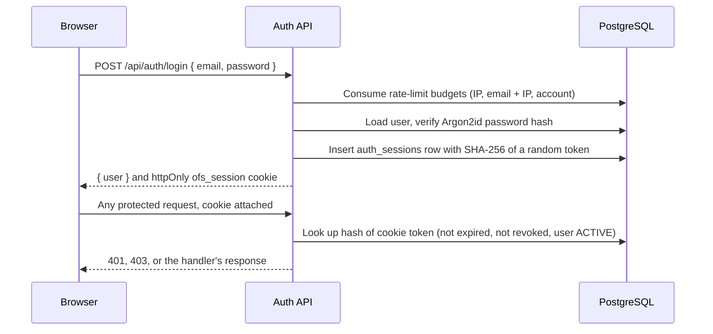
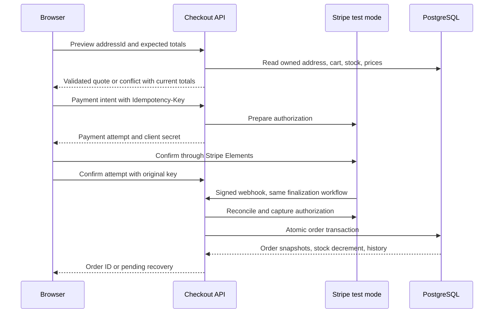
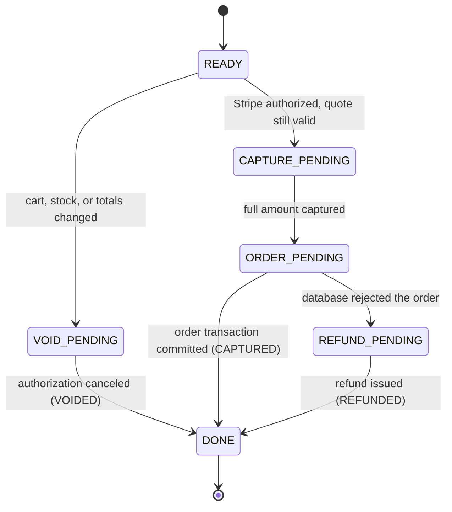
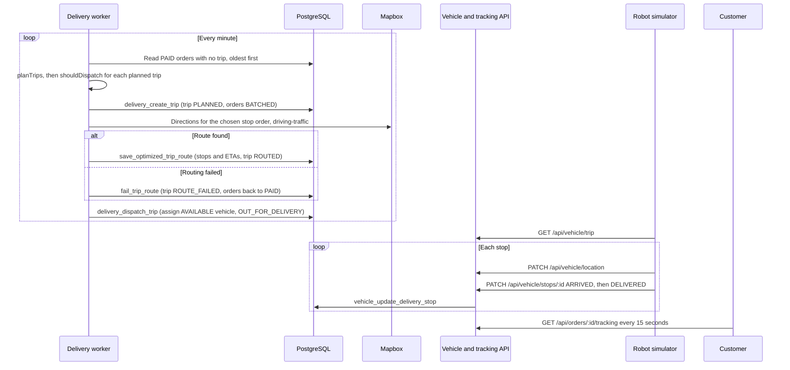

# Core API flows

API handlers live under `src/app/api`. These paths describe the implemented application. They are not a promise that every endpoint from the original design exists.

This page explains how the main workflows behave and why. For exact inputs, outputs, and error codes per endpoint, see the [API reference](api-reference.md). For the tables involved, see the [data model](data-model.md).

## Routes and access

| Routes | Access | Purpose |
| --- | --- | --- |
| `POST /api/auth/register`, `POST /api/auth/login` | Public, rate limited | Register customers and create sessions |
| `GET /api/auth/me`, `POST /api/auth/logout` | Session operations | Read identity and end a session |
| `GET /api/categories`, `GET /api/products`, `GET /api/products/:productId` | Public | Browse active products |
| `GET`, `POST /api/cart` | CUSTOMER | Read cart or set a line quantity |
| `GET`, `POST /api/addresses` | CUSTOMER | Read or save owned, eligible delivery addresses |
| `POST /api/checkout/preview` | CUSTOMER | Revalidate cart and return an authoritative quote |
| `POST /api/checkout/payment-intent` | CUSTOMER | Prepare or resume a Stripe test payment |
| `POST /api/checkout/confirm`, `POST /api/checkout/cancel` | CUSTOMER | Reconcile or cancel a payment attempt |
| `POST /api/webhooks/stripe` | Verified Stripe signature | Reconcile provider payment events |
| `GET /api/orders/:orderId/tracking` | CUSTOMER, owner only | Read order, trip, stop, ETA, and robot location data |
| `GET /api/staff/inventory`, `GET /api/staff/inventory/low-stock` | EMPLOYEE or MANAGER | Search inventory and low stock |
| `PUT /api/staff/inventory/:productId` | EMPLOYEE or MANAGER | Update and audit stock |
| `POST /api/admin/products` | MANAGER | Create a product |
| `PUT`, `DELETE /api/admin/products/:productId` | MANAGER | Edit or retire a product |
| `POST /api/admin/products/:productId/reactivate` | MANAGER | Reactivate a retired product |
| `GET /api/admin/audit-log` | MANAGER | Review staff changes |
| `GET /api/vehicle/trip` | VEHICLE | Read the assigned trip |
| `PATCH /api/vehicle/location` | VEHICLE | Report vehicle coordinates |
| `PATCH /api/vehicle/stops/:stopId` | VEHICLE | Advance an assigned stop's status |

Confirm HTTP exports in the handler before integrating a new caller. There is no public batching endpoint. The worker owns dispatch.

## Sign-in and sessions

The raw token exists only in the cookie. A database leak does not expose usable sessions. Sessions last 7 days and logout revokes the row. Rate-limit counters live in PostgreSQL, so restarting or adding app instances does not reset them. A successful login refunds the budget it consumed.

Code: `src/app/api/auth/login/route.ts`, `src/lib/auth/session.ts`, `requireRole.ts`, `sharedRateLimit.ts`.

## Cart mutations

`POST /api/cart` accepts `{ productId, quantity }`. Quantity is an integer. Zero removes the line. The server derives the customer from the session and reloads product price, weight, active state, and stock.

Money is cents and weight is hundredths of a pound. A weight of 1999 has free delivery. At 2000 the fee is 1000 cents. The warning starts at 1800. A cart can weigh exactly 20000, but an increase above it is rejected and leaves the saved cart intact.

The response contains updated items and totals. Malformed input returns 400, unavailable products or insufficient stock return 409, and an overweight change returns 422. The UI should show the error and keep the last confirmed state.

## Checkout and payment

Preview and payment preparation accept an owned `addressId` and an `expected` quote containing `subtotalCents`, `totalWeight`, `deliveryFeeCents`, `taxCents`, and `totalCents`. These values detect stale quotes. They do not override server prices. Tax is a simplified 5% demo policy on items.

Payment preparation requires an `Idempotency-Key` of 1 to 128 letters, digits, underscores, or hyphens. Confirmation requires the original key and an `attemptId`. A pending confirmation returns 202. Retry the same attempt instead of creating another charge.

`src/lib/payments/finalize.ts` implements the common reconciliation workflow used by browser confirmation and verified webhooks. The database order transaction locks relevant rows, recalculates totals, checks stock, creates order snapshots, decrements stock, links payment, checks out the cart, and adds history. Provider capture happens outside that transaction. Definite failures trigger compensation, while uncertain outcomes require reconciliation. See `scripts/recovery-worker.ts`.

### Finalization steps

`finalizePayment` saves its progress on the payment attempt as `finalize_step`. Each caller first claims the attempt with a short lease, so the browser, the webhook, and the recovery worker never finalize the same attempt at once. If a process dies, the next caller resumes from the saved step.

Three details matter:

- Before capturing, the server compares the Stripe intent with the saved attempt: same ID, amount, currency, test mode, manual capture, and attempt metadata. A mismatch stops the workflow.
- The quote is verified again before capture. If the cart changed, the authorization is voided and the customer is never charged.
- After capture, only a definite business rejection (for example, the last item sold out) leads to a refund. A timeout might mean the order did commit, so an unknown outcome retries the order transaction instead of refunding.

## Delivery pipeline

No HTTP endpoint triggers delivery. `scripts/delivery-worker.ts` runs `runDeliveryTick` (`src/lib/delivery/job.ts`) once per minute and never overlaps two ticks.

Each tick does four things in order:

1. **Recover.** Trips left `PLANNED` by a crashed process are routed again.
2. **Batch.** `planTrips` (`batching.ts`) sorts the queue by paid time. The oldest order starts a trip. The nearest remaining orders by straight-line distance join it while the trip stays within 10 orders and 20000 weight. An order that does not fit is skipped and seeds or joins a later trip.
3. **Decide.** `shouldDispatch` (`dispatch.ts`) accepts a trip that has 10 orders, weighs exactly 20000, or whose oldest order has waited the limit (20 minutes by default, `OFS_DELIVERY_WAIT_MINUTES`). Other orders stay in the queue for the next tick.
4. **Route and depart.** `routeTripById` (`src/lib/routing/service.ts`) loads stop locations from the database, orders them with a nearest-neighbor heuristic, and asks Mapbox for the traffic-aware road route and travel times. `departWithFreshRoute` (`departure.ts`) then assigns an AVAILABLE vehicle. A trip with no vehicle stays `ROUTED` and is retried next tick. If its saved route is more than 60 seconds old by then, it is routed again before departure so the ETAs reflect current traffic.

When routing fails, the trip becomes `ROUTE_FAILED` and its orders return to `PAID` with their original paid times, so they keep their place in the queue.

## Robot updates and tracking

The robot is an HTTP client with a VEHICLE account. It reads its trip, reports its location and battery, and marks each stop `ARRIVED` and then `DELIVERED`. The database function `vehicle_update_delivery_stop` locks the vehicle row, checks that the stop belongs to the vehicle's current trip, and applies the change. `DELIVERED` also moves the order to `DELIVERED` and writes history. The last delivery completes the trip and returns the vehicle to `AVAILABLE`.

A repeated `DELIVERED` for a stop the same robot already delivered returns success again. The simulator can therefore retry after a lost response without causing an error or a duplicate.

Customers read progress through `GET /api/orders/:orderId/tracking`. It combines the order status, trip status, stop status, estimated arrival, route geometry, destination, and the robot's last location. The tracking page polls it every 15 seconds.

## Notifications

Order and stop status changes queue rows in `notifications` inside the same database transaction as the change, so a message is never lost if the app crashes afterward. Checkout confirmation, the Stripe webhook, and robot stop updates send queued messages right after responding. The recovery worker retries anything still pending. With no email provider configured, messages stay queued and nothing is marked as sent.

## Authorization and errors

`requireRole` returns 401 for missing or invalid sessions and 403 for the wrong role. Services also check resource ownership. A customer's private order page treats another customer's order as missing. The tracking API returns 403 for an existing order owned by another customer, and 404 for an absent order. Unknown routes return 404.

API errors generally use `{ error: { code, message } }`. Conflict responses can include current values so the UI can reload and ask the customer to review changes. Never use an HTTP success response alone as evidence that a pending payment created an order.
