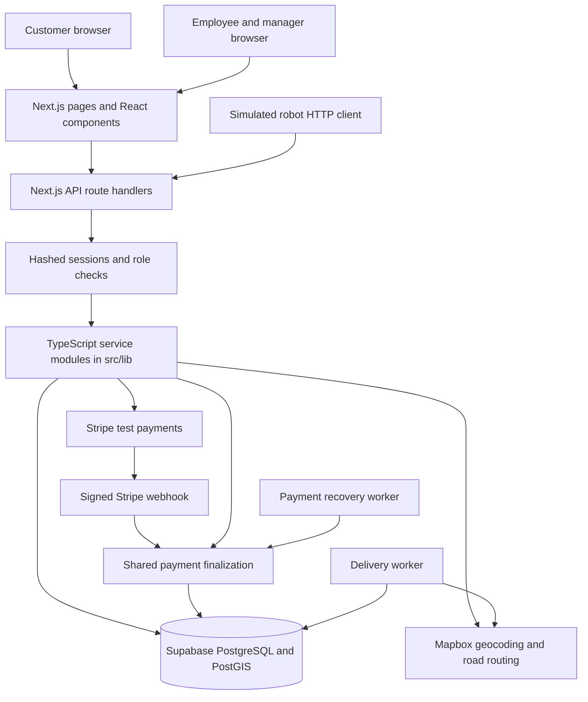

# Architecture and code ownership

OFS serves a single grocery store in Downtown San Jose. Next.js hosts the customer storefront, staff dashboard, and HTTP API. Background processes dispatch deliveries and reconcile incomplete payments. PostgreSQL on Supabase holds persistent state, with PostGIS for geographic data.

The [README diagram](../README.md#architecture) explains the product components for a nontechnical audience. The diagram below shows the implementation and provider boundaries. The service names in the project design correspond to modules in `src/lib`, rather than separate deployments. See [implementation decisions](implementation-decisions.md) for differences between the design and current implementation.

## Technical components

## Follow a request through the code

1. A page in `src/app` loads session-specific data or renders components from `src/components`.
2. A browser action calls a handler in `src/app/api`. The handler parses JSON and calls `requireRole` in `src/lib/auth/requireRole.ts`.
3. The session lookup hashes the cookie token and reads the matching stored session. The handler passes that user's ID to the service. Client-supplied identity cannot replace it.
4. A service in `src/lib` calculates rules and calls a database adapter or transactional PostgreSQL function. `src/lib/supabase/admin.ts` creates the privileged server client, so handlers and services must enforce roles and ownership before accessing data.
5. The handler returns the committed result or a structured error. UI components display server totals and preserve the previous cart after a rejected change.

Pure rules such as `src/lib/cart/pricing.ts` and `src/lib/delivery/batching.ts` are separated from provider calls. This lets unit tests cover boundary rules without contacting Stripe or Mapbox. Database tests exercise the actual SQL functions and locks.

## Find the code for a presentation

| Topic | Start here | Follow into |
| --- | --- | --- |
| Login and roles | `src/app/api/auth/login/route.ts` | `src/lib/auth/session.ts`, `src/lib/auth/requireRole.ts` |
| Cart fee and weight limits | `src/lib/cart/pricing.ts` | `src/lib/cart/service.ts`, cart hardening migrations |
| Checkout preview | `src/app/api/checkout/preview/route.ts` | `src/lib/checkout/service.ts`, `src/lib/checkout/tax.ts` |
| Payment creation | `src/app/api/checkout/payment-intent/route.ts` | `src/lib/payments/backend.ts`, `service.ts` |
| Finalization and recovery | `src/lib/payments/finalize.ts` | `finalize-backend.ts`, `recovery.ts`, payment finalization migrations |
| Staff stock changes | `src/app/api/staff/inventory/[productId]/route.ts` | Inventory transaction migrations and `src/lib/audit/log.ts` |
| Delivery dispatch | `scripts/delivery-worker.ts` | `src/lib/delivery/dispatch.ts`, `departure.ts` |
| Routing | `src/lib/routing/service.ts` | `optimization.ts`, `mapbox.ts`, `persistence.ts` |
| Robot updates | `scripts/robot-simulator.ts` | `src/lib/vehicle`, `src/app/api/vehicle` |
| Tracking data and map | `src/app/api/orders/[orderId]/tracking/route.ts` | `src/lib/orders/tracking.ts`, `src/components/tracking` |

## Persistent state and concurrency

Cart changes and checkout serialize conflicting mutations in PostgreSQL. Checkout snapshots names, prices, weights, and the delivery address so later catalog edits cannot change an existing purchase. The order transaction decrements stock, links the payment, checks out the cart, and inserts status history together.

Payment finalization crosses a provider boundary and a database boundary. They cannot share one transaction. The recovery worker reconciles uncertain outcomes and retries unfinished work. A confirmed database rejection after capture requires a refund. An uncertain response requires checking whether an order already committed before refunding.

Staff stock updates can include the quantity the employee originally saw. A stale edit returns a conflict instead of overwriting another employee's change. Audit records retain old and new values. Products are retired and reactivated, never deleted by the product API.

## Delivery lifecycle

The delivery worker checks immediately and then every minute. The oldest paid order starts a candidate batch and nearby orders fill it, subject to 10 orders and 200 lb. The worker dispatches when capacity is full or the oldest order has waited 20 minutes. Mapbox supplies road geometry and travel times after a geographic heuristic chooses stop order.

Routing failure marks the trip `ROUTE_FAILED` and returns orders to the queue using their original paid times. Routed trips wait for an AVAILABLE vehicle. Departure atomically assigns the vehicle and changes order and trip state to `OUT_FOR_DELIVERY`. The simulated robot uses authenticated HTTP endpoints to report progress and location.

Customers follow an order at `/track/<order-id>`. The page polls the tracking API every 15 seconds and shows the route, destination, and robot on a map. Rehearse the worker and robot separately using [the worker guide](run-workers.md).

See [API flows](api-flows.md#delivery-pipeline) for the delivery sequence and [the data model](data-model.md) for the tables involved.
