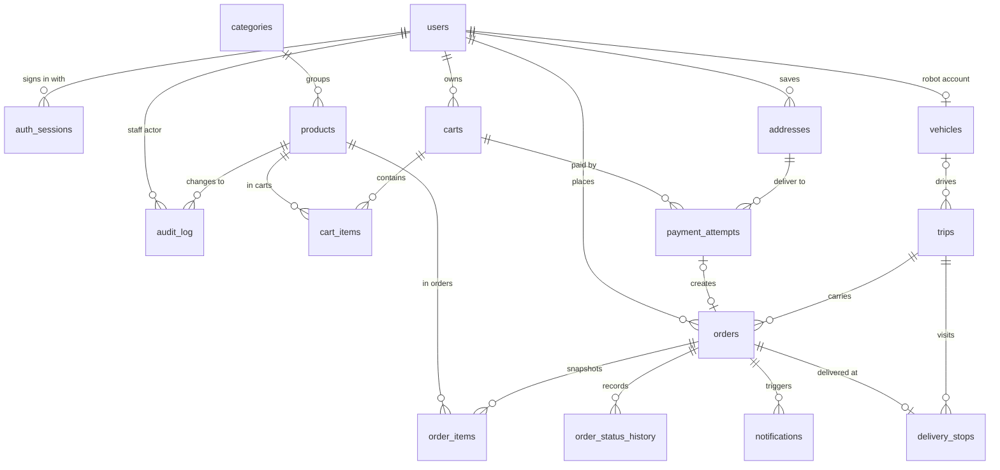

# Data model

PostgreSQL on Supabase holds all persistent state. PostGIS stores delivery locations as `geography(Point, 4326)`. The schema is defined by the migrations in `supabase/migrations`; this page summarizes what they produce.

Conventions: UUID primary keys, `timestamptz` for times, snake_case names, money in integer cents, weight in integer hundredths of a pound.

## Tables and relationships

| Table | Owner in `src/lib` | Purpose |
| --- | --- | --- |
| `users` | `auth` | Accounts with a role (CUSTOMER, EMPLOYEE, MANAGER, VEHICLE) and an Argon2id password hash |
| `auth_sessions` | `auth` | One row per session; stores the token hash, expiry, and revocation time |
| `auth_rate_limits` | `auth` | Shared counters for registration and login attempts; keys are hashed |
| `addresses` | `auth` | Geocoded delivery addresses inside the service area |
| `categories`, `products` | `catalog`, `products`, `inventory` | The catalog. Stock is `products.stock_quantity`; retired products have `is_active = false` |
| `audit_log` | `audit` | Old and new values for every staff stock or product change |
| `carts`, `cart_items` | `cart` | One ACTIVE cart per customer; lines hold only product ID and quantity |
| `payment_attempts` | `payments` | One row per checkout attempt: idempotency key, quote snapshot, Stripe ID, status, finalization step |
| `orders`, `order_items` | `orders` | The purchase, with snapshots of names, prices, weights, and the delivery address |
| `order_status_history` | `orders` | One row per order status change |
| `trips` | `delivery` | A robot trip: order count, total weight, route geometry, assigned vehicle |
| `delivery_stops` | `routing` | One stop per order on a trip, in route order, with an estimated arrival |
| `vehicles` | `vehicle` | Robot status, battery, current trip, and last reported location |
| `notifications` | `notifications` | Outbox of customer emails with retry state |

There is no separate inventory table. Stock lives on the product row, so a checkout can lock the product and decrement its stock in the same transaction that creates the order.

No card numbers, CVV, or expiry dates are stored anywhere. `payment_attempts` keeps only the Stripe PaymentIntent ID, the refund ID, and statuses.

## Status values

| Entity | Values |
| --- | --- |
| Order | `PAID`, `PREPARING`, `BATCHED`, `OUT_FOR_DELIVERY`, `DELIVERED`, `CANCELED` |
| Cart | `ACTIVE`, `CHECKED_OUT` |
| Payment attempt | `PENDING`, `AUTHORIZED`, `CAPTURED`, `FAILED`, `VOIDED`, `REFUNDED` |
| Payment finalization step | `READY`, `CAPTURE_PENDING`, `ORDER_PENDING`, `VOID_PENDING`, `REFUND_PENDING`, `DONE` |
| Trip | `PLANNED`, `ROUTED`, `OUT_FOR_DELIVERY`, `COMPLETED`, `ROUTE_FAILED` |
| Delivery stop | `PENDING`, `EN_ROUTE`, `ARRIVED`, `DELIVERED`, `DELAYED`, `FAILED` |
| Vehicle | `AVAILABLE`, `DELIVERING`, `OFFLINE` |
| Notification | `PENDING`, `SENT`, `FAILED` |
| User | `ACTIVE`, `DISABLED`, `LOCKED` |

## Constraints that back up the code

The TypeScript services enforce the rules first. These database constraints are the safety net.

| Rule | Constraint |
| --- | --- |
| Cart and order weight at most 200.00 lb | `orders.total_weight <= 20000`, checked again inside the cart function |
| Trip at most 10 orders and 200.00 lb | `trips.order_count <= 10`, `trips.total_weight <= 20000` |
| Stock never negative | `products.stock_quantity >= 0` |
| One ACTIVE cart per customer | Partial unique index on `carts (customer_id)` |
| One default address per customer | Partial unique index on `addresses (customer_id)` |
| One payment per order | Partial unique index on `payment_attempts (order_id)` |
| One charge per idempotency key | Unique `payment_attempts.idempotency_key` |
| One stop per order | Unique `delivery_stops.order_id` |
| One active trip per vehicle | Partial unique index on `trips (vehicle_id)` where `OUT_FOR_DELIVERY` |
| Emails are unique regardless of case | Unique index on `lower(users.email)` |

## Database functions

Operations that must be all-or-nothing are PostgreSQL functions called through `db.rpc(...)`. Each one runs in a single transaction and takes the row locks it needs.

| Area | Functions | What they guarantee |
| --- | --- | --- |
| Cart | `customer_get_or_create_cart`, `customer_get_cart`, `customer_set_cart_item` | Stock and the 200 lb limit are checked under a lock; a rejected change leaves the cart unchanged |
| Checkout | `checkout_reserve_payment_attempt`, `checkout_attach_payment_intent`, `customer_read_address_location` | Same idempotency key returns the same attempt |
| Finalization | `checkout_claim_finalization`, `checkout_advance_finalization`, `checkout_release_finalization` | Only one caller finalizes an attempt at a time; progress survives a crash |
| Order creation | `order_create_from_payment` | Locks payment, cart, address, and products; rechecks totals and stock; writes order, items, stock decrement, payment link, cart status, and history together |
| Recovery | `checkout_claim_recovery`, `checkout_finish_recovery`, `claim_notifications`, `finish_notification` | Leases keep two workers off the same item; retries are bounded |
| Staff | `staff_set_inventory_quantity`, `admin_create_product`, `admin_update_product`, `admin_retire_product`, `admin_reactivate_product` | The change and its audit row commit together |
| Delivery | `order_read_pending_delivery_queue`, `delivery_create_trip`, `get_trip_order_locations`, `save_optimized_trip_route`, `fail_trip_route` | Orders join exactly one trip; a routing failure returns them to the queue |
| Departure | `delivery_prepare_departure_route`, `delivery_dispatch_trip` | Vehicle assignment and the move to `OUT_FOR_DELIVERY` are atomic |
| Robot | `vehicle_update_delivery_stop` | A vehicle changes only its own stops; repeated updates are safe |
| Auth | `auth_consume_rate_limit`, `auth_refund_rate_limit` | Limits are shared across app instances |
| Notifications | `queue_order_notification`, `notify_on_order_status`, `notify_on_delivery_stop` | Status changes queue emails inside the same transaction |

## Changing the schema

Add a new migration with `npx supabase migration new <name>`. Never edit a migration that has been applied. See the [README database section](../README.md#database) for applying migrations locally and to the hosted project.
